<picture>
  <source media="(prefers-color-scheme: dark)" srcset="./assets/header-dark.svg">
  <source media="(prefers-color-scheme: light)" srcset="./assets/header-light.svg">
  
</picture>

 

I build small products, tools, and experiments for the web — mostly in **Python** and **TypeScript**.
Into React, FastAPI, automation and product design. Learning by shipping.

 

### ◆ Building

**[FileConvert_robot](https://t.me/FileConvert_robot)** — file conversion bot for Telegram 
`python` `bot`

**[Quizzz](https://github.com/meytyy/quizloom)** — create and run interactive quizzes 
`react` `typescript`

**[Focus Fox](https://github.com/meytyy/focus-fox)** — calm focus timer that pauses distracting sites 
`browser-extension` `javascript`

 

### ◆ Stack

 

<picture>
  <source media="(prefers-color-scheme: dark)" srcset="https://raw.githubusercontent.com/meytyy/meytyy/output/snake-dark.svg">
  <source media="(prefers-color-scheme: light)" srcset="https://raw.githubusercontent.com/meytyy/meytyy/output/snake.svg">
  
</picture>
